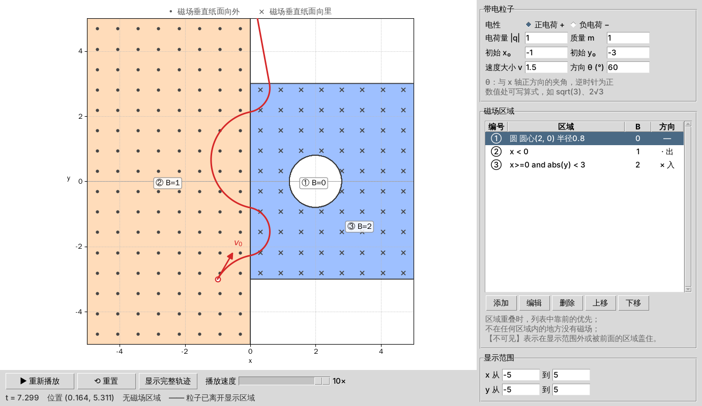

# magnet_test：带电粒子在磁场中的运动演示

供高中物理课堂使用的桌面小程序，用来演示带电粒子在**垂直纸面的磁场**中运动（限于二维平面）。
可以自定义粒子，也可以把平面划分成若干区域，每个区域单独设置磁场的大小和方向，用来演示复合磁场的题目。



## 安装与运行

需要 Python 3.8 及以上版本（Windows 用 python.org 的官方安装包即可，自带 Tkinter）。

```bash
pip install -r requirements.txt
```

```bash
python main.py
```

### 打包成 exe（可选）

在 Windows 上执行下面的命令，生成 `dist/磁场演示.exe`，可以拷到教室电脑上双击运行，那台电脑不需要安装 Python：

```bash
pip install pyinstaller
```

```bash
pyinstaller --noconfirm --onefile --windowed --name 磁场演示 main.py
```

## 使用方法

### 1. 设置粒子（右上“带电粒子”）

| 项目 | 说明 |
| --- | --- |
| 电性 | 正电荷 / 负电荷 |
| 电荷量 \|q\|、质量 m | 只填大小，默认都为 1 |
| 初始 x₀、y₀ | 粒子出发的位置 |
| 速度大小 v | ≥ 0 |
| 方向 θ | 与 x 轴正方向的夹角，**逆时针为正**，单位为度。例如 90 表示竖直向上，-30 表示右下方 |

数值处都可以写算式，例如 `sqrt(3)`、`2√3`、`pi/2`、`1/3`。

### 2. 设置磁场区域（右侧“磁场区域”）

点“添加”，选择区域形状、填写参数，再填磁感应强度 B 和方向（穿出纸面 · / 穿入纸面 ×）。

| 形状 | 参数 | 例子 |
| --- | --- | --- |
| 整个平面 | 无 | 匀强磁场 |
| 半平面 | x > / x < / y > / y < 某个值 | `x > 0` |
| 条形区域 | a < x < b（竖直）或 a < y < b（水平） | 宽度为 d 的条形磁场 |
| 矩形 | x 和 y 的范围 | |
| 圆形 | 圆心、半径 | 圆形磁场区域 |
| 圆环 | 圆心、内半径、外半径 | |
| 自定义不等式 | 任意条件 | `x > 0 and x^2 + y^2 < 4` |

**区域重叠时，列表中靠前的区域优先**，可以用“上移 / 下移”调整顺序；不在任何区域内的地方没有磁场。
把某个区域的 B 设为 0 并放在前面，就能在别的区域里“挖空”。例如先加“圆形 半径 1，B = 0”，再加“圆形 半径 2，B = 1”，得到一个圆环形磁场。

列表中标【不可见】的区域，要么在显示范围之外，要么被前面的区域完全盖住了。

#### 自定义不等式的写法

| 内容 | 写法 |
| --- | --- |
| 变量 | `x`、`y`，以及 `r`（到原点的距离，r = √(x²+y²)） |
| 比较 | `>` `<` `>=` `<=`，也可以写 `≥` `≤`；支持连写，如 `-1 < x < 1` |
| 组合 | `and` / `且`，`or` / `或`，`not` / `非`；也可以用 `&&`、`\|\|` |
| 运算 | `+ - * /`，乘方写 `^` 或 `**`，数字和字母相乘可省略乘号，如 `2x` |
| 函数 | `sqrt` `abs` `sin` `cos` `tan` `atan2` `exp` `ln` 等，常数 `pi` |

例子：

- 第一象限内半径为 2 的四分之一圆：`x > 0 and y > 0 and r < 2`
- 直线 y = x 上方：`y > x`
- 两条平行线之间的倾斜条带：`abs(y - x) < 1`
- 正方形（菱形摆放）：`abs(x) + abs(y) < 2`
- 圆环的上半部分：`1 < r < 2 且 y > 0`

### 3. 播放演示（画面下方）

- **开始 / 暂停 / 继续**：也可以按空格键
- **重置**：回到初始状态
- **显示完整轨迹**：直接画出整条轨迹
- **播放速度**：0.1× ~ 10×。1× 时粒子大约 6 秒走过一个画面宽度

粒子离开显示区域后自动停止；如果粒子一直在磁场里转圈，走过约 40 个画面宽度的路程后停止。
画面下方的状态栏会显示当前时刻、位置和粒子所在的区域。

## 物理约定

- 采用无单位的“教学单位”，q、m、v、B 都可以直接用简单的数字，便于和题目对照：
  - 轨道半径 r = mv / (|q|B)
  - 周期 T = 2πm / (|q|B)
- 洛伦兹力 F = qv × B。磁场穿出纸面时，正电荷顺时针转、负电荷逆时针转；磁场穿入纸面时方向相反。
- 同一区域内磁场均匀，每一步都用匀速圆周运动的解析公式推进，没有积分误差，圆不会越画越大。
  粒子越过区域边界时，程序用二分法找到越界点，在边界上准确换用新磁场，因此“对称射入对称射出”这类结论能精确呈现。

## 项目结构

```
main.py                    启动入口
magnet_sim/
  app.py                   主窗口（Tkinter + Matplotlib）
  region_dialog.py         添加/编辑区域的对话框
  plotting.py              绘制磁场区域、符号、标签
  physics.py               粒子运动计算
  field.py                 复合磁场（区域列表 + 优先级）
  regions.py               各种区域形状
  expr.py                  安全的数学表达式解析（不等式、算式输入）
tests/                     单元测试（pytest）
```

运行测试：

```bash
pip install pytest
```

```bash
python -m pytest
```
